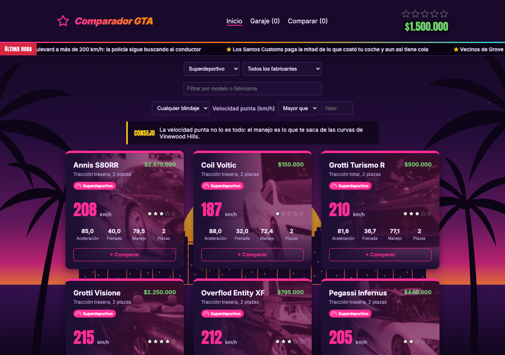
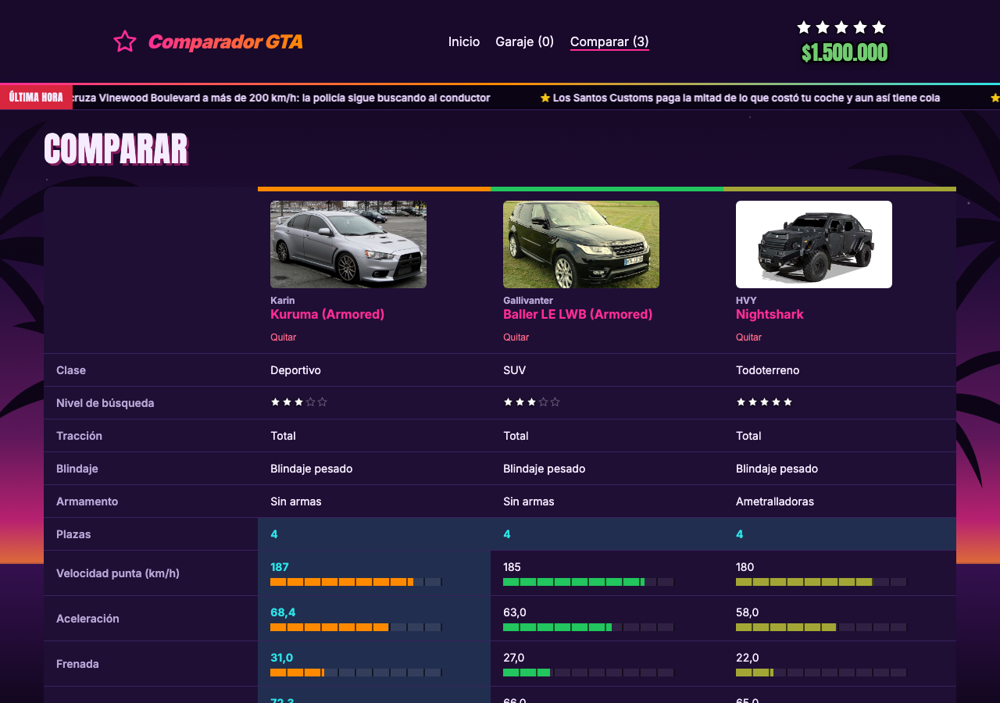

# Comparador de vehículos de GTA

Comparador de vehículos de GTA Online con ambientación del juego: listado por clase y fabricante con buscador y filtros, ficha de cada vehículo, comparación lado a lado de hasta tres y un garaje donde comprar y vender con tu propio dinero.





## Qué tiene

- **Listado**: cada tarjeta lleva de fondo la sombra difuminada de su propio vehículo, con la velocidad, las estadísticas y su nivel de búsqueda.
- **Ficha**: foto del vehículo, barras de estadísticas como las del concesionario del juego, datos técnicos y botones para comparar, comprar o vender.
- **Comparar**: hasta tres vehículos en una tabla, con el mejor de cada fila resaltado.
- **Garaje**: empiezas con $1.500.000. Lo que compras va al garaje y Los Santos Customs te lo recompra por la mitad.
- **HUD**: arriba a la derecha, el dinero y las estrellas de búsqueda del vehículo más buscado que tengas en la comparación.
- **Ambientación**: fondo de atardecer de Vice City, cinta de noticias de Los Santos, consejos como los de las pantallas de carga, avisos de «¡Comprado!» y «Sin fondos»… y algún truco escondido.

El dinero, el garaje y la comparación se guardan en el `localStorage` del navegador. Para empezar de cero, bórralo desde las herramientas de desarrollo.

## Arrancar

```bash
npm install
npm run dev
```

La primera vez, para la skill `validation`: `npx playwright install chromium`.

## Dónde está cada cosa

| fichero | qué hay |
|---|---|
| `src/App.tsx` | las páginas: listado, ficha, comparar y garaje |
| `src/gta.tsx` | lo del juego: HUD, estrellas, barras, avisos, trucos, noticias, consejos y el fondo de Vice City |
| `src/fotos.tsx` | la foto de cada vehículo y su sombra en el listado |
| `src/fotos.json` | qué foto lleva cada modelo, con su autor y licencia |
| `src/siluetas.tsx` | siluetas en SVG por tipo de carrocería, por si una foto no carga |
| `public/coches/` | las fotos |

## Las fotos

Cada vehículo lleva una foto del coche real en el que se inspira el modelo del juego (el Zentorno, por ejemplo, es un Lamborghini Sesto Elemento). Están sacadas de Wikimedia Commons con licencia libre. La ficha de cada vehículo cita al autor, y la lista completa está en [`public/coches/CREDITOS.md`](public/coches/CREDITOS.md).

## La API

Los datos los sirve una API simulada que arranca con `npm run dev` (`api/plugin.ts` sobre `api/vehicles.json`). Hace de servicio externo: no se toca, se consume.

| endpoint | devuelve |
|---|---|
| `GET /api/vehicle/menu/class` | las clases |
| `GET /api/vehicle/menu/make?class=Super` | los fabricantes de una clase |
| `GET /api/vehicle/menu/model?class=Super&make=Pegassi` | los modelos de un fabricante |
| `GET /api/vehicle/menu/options?class=…&make=…&model=…` | las versiones de un modelo |
| `GET /api/vehicle/:id` | la ficha de una versión |

Todo llega como texto y la velocidad, en millas por hora. Las estadísticas son aproximadas y están inventadas para la práctica. GTA y Grand Theft Auto son marcas de Rockstar Games; este proyecto no tiene relación con ellas.

## Las skills

En `.claude/skills/`:

| skill | qué hace | dónde corre |
|---|---|---|
| `/grill-me` | Te interroga hasta escribir la especificación en `specs/` | en tu conversación |
| `/implement <tarea o spec>` | Fija los criterios, implementa y llama a `reviewer` y `validation`; repite con los arreglos hasta 3 rondas | en tu conversación |
| `/reviewer <slug>` | Revisa el diff contra los criterios y `CONTEXT.md` y da un veredicto APTO o NO APTO | en un subagente (`context: fork`) |
| `/validation <slug>` | Comprueba cada criterio en Chromium con Playwright y saca una captura de cada uno | en un subagente (`context: fork`) |

`reviewer` y `validation` no ven la conversación en la que se escribió el código: solo los criterios (`.claude/tmp/<slug>/criterios.md`) y el diff. Así no se dan la razón a sí mismas.

## Práctica

1. **A pelo.** Lanza `/implement` con el prompt tal cual. Mira qué supuestos ha elegido y si `reviewer` y `validation` los han dado por buenos.
2. **Con especificación.** En una sesión nueva, `/grill-me` con el mismo prompt hasta tener `specs/<tarea>.md`, y después `/implement specs/<tarea>.md`.
3. **Cotejo.** ¿Qué ha cazado cada skill? ¿Qué se ha colado en las dos vueltas?

> Añade al comparador cuál de los coches es mejor para dar un golpe.
